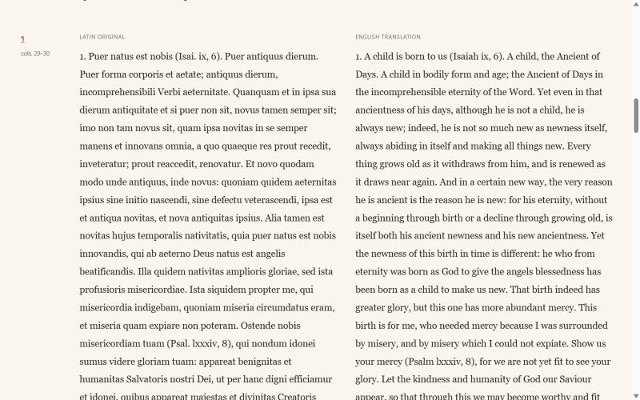

# <span lang="la">Sermones per annum</span>

**Read the library: <https://financeprofessormckee.github.io/Liturgical-Sermons/>**

<span lang="la">Sermones per annum</span> is a small library of historical Catholic sermons for
the feasts and seasons of the liturgical year. Each sermon is given in English
and, where the original is Latin or French, beside its original text, with notes,
Scripture references and a citation of the printed edition from which it was taken.

The collection is meant for devotional readers who want to read these sermons in
English, and for students and researchers who want to see what the source actually
says. It is a personal project, begun as a pilot and intended to grow.

## Scope

The library collects sermons by Catholic preachers, chiefly from about AD 1000
to 1920. Preference is given to Saints, Blesseds, Venerables and Servants of God,
and to clergy in good standing with the Church, and modest preference to sermons
that have no accessible English translation. Selection is described in the
[editorial policy](EDITORIAL_POLICY.md#scope-and-selection).

## The collection at present

69 sermons by 3 authors. 65 are translated from Latin or French; 4 are English originals.

| Author | Sermons | Original language | Period |
| --- | --- | --- | --- |
| Guerric of Igny | 55 | Latin | 12th century |
| Louis Bourdaloue | 10 | French | 17th–18th century |
| John Henry Newman | 4 | English | 19th century |

The machine-readable [catalog.json](catalog.json) lists every sermon with its
author, date, language, occasion, topics, Scripture references, source edition and
the review status of its English text. It is generated with the site and is the
place to look for current figures.

## Reading the sermons

- **Reading (English).** The English text alone, with the notes closed. For an
  English original such as Newman, the sermon as printed.
- **Scholar.** The original and the English in aligned paragraphs, with the page
  or column of the printed edition in the margin and the notes open. Translated
  sermons can also be shown in the original only.
- **Notes.** Numbered notes explain Scripture references, difficult readings and
  printed anomalies, and link back to the passage they annotate. References the
  edition leaves uncited are marked as added by the editors.
- **Edition and translation.** Each sermon gives its full citation, a link to the
  digitized edition, the date of the book and the approximate date of the sermon.
- **Browsing.** The library can be filtered by author, century, original language,
  historical occasion, topic and the traditional (1962) calendar.
- **Search.** Search covers the original and English texts, the introductions,
  notes and Scripture references. Accents and capitals are ignored.
- **Permanent links.** Every paragraph and note has its own link.

Light and dark themes are available. The site has no accounts, no tracking and no
analytics.



## Sources and method

The texts are transcribed from printed editions in the public domain in the United
States, checked against page images of those editions, and cited by volume and
page or column. Historical spelling is kept, and printed errors are noted rather
than silently corrected.

The Latin and French sermons have AI translations reviewed against the original,
separately, by AI. Bourdaloue on Prayer also offers A. Carroll's 1843 human
translation, transcribed and independently checked with AI assistance. Its
historical omissions and differences are explained in translation notes. Readers
can select either version, with Carroll initially preferred. **No human language review
has occurred.** Each translated sermon says so. The
[editorial policy](EDITORIAL_POLICY.md) sets out the practice in full.

## Using the site locally

The site is static HTML, CSS and JavaScript with no build step in this repository.
Open `index.html` in a browser, keeping the `assets/` and `sermons/` folders beside
it; search and filters work from the file system. Alternatively:

```
python -m http.server 8000
```

and visit <http://localhost:8000/>.

The pages, `catalog.json` and the search index are generated from structured
records in a separate authoring project and copied here. Edits made directly to
the generated files are overwritten at the next update; see
[CONTRIBUTING.md](CONTRIBUTING.md).

## Plans

More sermons and more authors will be added, including complete cycles where
the editions allow. I also intend to connect the library to the liturgical
calendar in the manner of [Chant of the Day](https://github.com/financeprofessormckee/Chant-Of-The-Day),
so that each day of the year points to its sermons. Other possibilities under consideration are a cross-sermon index
of Scripture and help with Latin and French vocabulary while reading.

## Corrections

Reports of transcription errors, mistranslations, wrong references, broken links
and bibliographic mistakes are welcome. Use the
[Feedback page](https://financeprofessormckee.github.io/Liturgical-Sermons/feedback.html)
on the site, which opens a prefilled GitHub issue for the sermon in question, or
open an issue here directly. [CONTRIBUTING.md](CONTRIBUTING.md) explains what to
include.

## Rights and reuse

- The historical editions are in the public domain in the United States.
- The digitized copies of those editions belong to the libraries and archives
  named with each sermon. This library reproduces its own transcriptions, not
  their page images.
- The English translations, introductions and notes prepared for this library are
  licensed under [CC BY 4.0](https://creativecommons.org/licenses/by/4.0/). Text
  generated wholly by AI may not be protected by copyright in the United States;
  the licence applies to whatever rights exist in this material.
- The code of the website is released under the MIT License.

See [LICENSE](LICENSE) for the full terms and the
[Texts & Licences page](https://financeprofessormckee.github.io/Liturgical-Sermons/texts-and-licences.html)
for the source of each sermon.
